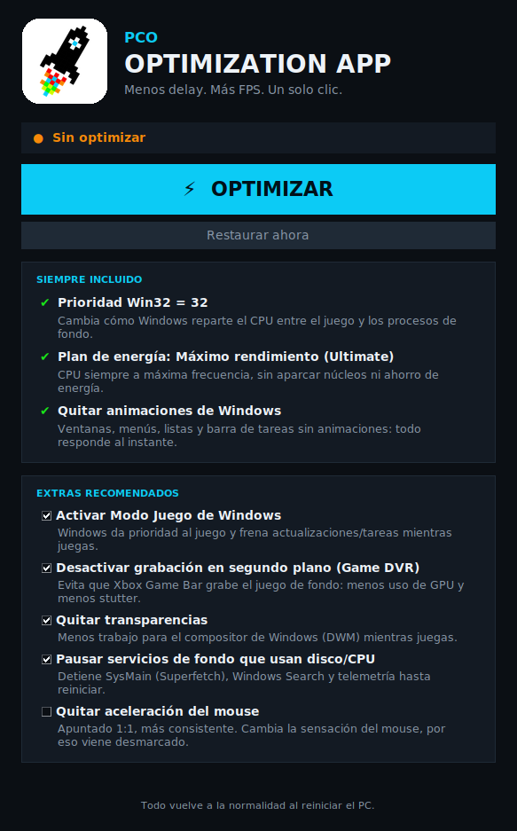

# PCO OPTIMIZATION APP

App de escritorio para Windows 10/11 de **PCO**. Optimiza el PC para jugar con **menos delay y más FPS**
con un solo botón, y **todo vuelve a la normalidad al reiniciar**.

## Cómo funciona

1. El usuario abre la app (pide permisos de administrador) y pulsa **OPTIMIZAR**.
2. Antes de tocar nada, la app guarda los valores actuales en
   `C:\ProgramData\PCO Optimization\backup.json`.
3. Aplica las optimizaciones y crea una tarea programada (`PCO Optimization\Restaurar al reiniciar`).
4. Al reiniciar e iniciar sesión, esa tarea ejecuta la app con `--restore` en silencio, devuelve cada
   valor al original y se borra a sí misma.
   - Si la tarea no pudiera ejecutarse (p. ej. el .exe se movió), la app restaura sola la próxima vez que se abra.
   - El botón **Restaurar ahora** deshace todo sin reiniciar.

Solo se usan ajustes que funcionan **en caliente** (sin reiniciar): si un ajuste necesitara reinicio para
activarse, se revertiría antes de hacer efecto.

## Optimizaciones

**Siempre incluidas (pedidas por PCO)**

| Ajuste | Qué hace |
|---|---|
| `Win32PrioritySeparation = 32` | Reparto de CPU entre el juego y los procesos de fondo. Valor en `optimizer.py` → `WIN32_PRIORITY_VALUE`. |
| Plan de energía **Máximo rendimiento (Ultimate)** | Crea una copia del plan Ultimate y lo activa. En equipos que no lo permiten (algunos portátiles con Modern Standby) usa *Alto rendimiento*. |
| Sin animaciones de Windows | Animación de ventanas al minimizar/maximizar, menús, listas, tooltips, desplazamiento suave y barra de tareas. |

**Extras recomendados (el usuario los marca o desmarca)** — ninguno cambia cómo se juega:

| Ajuste | Por defecto | Por qué |
|---|---|---|
| Modo Juego de Windows | ✔ | Prioriza el juego y frena Windows Update/tareas de fondo mientras juegas. |
| Desactivar Game DVR | ✔ | La grabación en segundo plano de Xbox Game Bar consume GPU y provoca stutter. |
| Quitar transparencias | ✔ | Menos carga para el compositor de Windows (DWM). |
| Pausar SysMain, Windows Search y telemetría | ✔ | Se detienen (no se deshabilitan): menos picos de disco/CPU. Vuelven solos al reiniciar. |
| Quitar aceleración del mouse | ✖ | Apuntado 1:1. Viene desmarcado porque cambia la sensación del mouse. |

## Compilar el .exe

**Automático (GitHub):** cada push que toque `pco-optimizer/` compila el .exe en GitHub Actions
(workflow *Build PCO Optimization App*). Descárgalo desde la pestaña **Actions → última ejecución →
Artifacts → PCO_Optimization_App**.

**Manual (en un PC con Windows):** instala [Python 3.12](https://www.python.org/downloads/) y ejecuta
`build.bat`. El resultado queda en `dist\PCO_Optimization_App.exe`.

Para probar sin compilar: `python pco_app.py` (en Windows).

## Archivos

- `pco_app.py` — interfaz (tkinter, sin dependencias externas).
- `optimizer.py` — ajustes: copia de seguridad, aplicar y restaurar. Para añadir uno nuevo, crea una
  clase `Tweak` y agrégala a `EXTRA_TWEAKS`.
- `assets/` — logo e ícono de PCO.
- Registro de acciones: `C:\ProgramData\PCO Optimization\pco.log`.

## Antes de vender

- **Firma de código:** sin un certificado de firma, Windows SmartScreen mostrará "Windows protegió su PC".
  Un certificado de firma de código (OV/EV) lo evita y da confianza al cliente.
- Algunos antivirus marcan los .exe de PyInstaller como sospechosos; firmarlo también ayuda.
